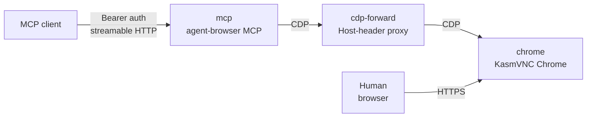

<div align="center">

# Remote Browser

**Give your agent access to a browser that's always available.**

A self-hosted Docker Compose stack: real Chrome under KasmVNC, driven by the
official [`agent-browser`](https://github.com/vercel-labs/agent-browser) MCP
server. You and the agent share one browser, one set of cookies, one set of
sign-ins.

<a href="#install"><kbd>&nbsp;<br>&nbsp;&nbsp;&nbsp;Install&nbsp;&nbsp;&nbsp;<br>&nbsp;</kbd></a>
<a href="#quickstart"><kbd>&nbsp;<br>&nbsp;&nbsp;&nbsp;Quickstart&nbsp;&nbsp;&nbsp;<br>&nbsp;</kbd></a>
<a href="#how-it-works"><kbd>&nbsp;<br>&nbsp;&nbsp;&nbsp;How it works&nbsp;&nbsp;&nbsp;<br>&nbsp;</kbd></a>
<a href="#configuration"><kbd>&nbsp;<br>&nbsp;&nbsp;&nbsp;Configuration&nbsp;&nbsp;&nbsp;<br>&nbsp;</kbd></a>

<!-- TODO: demo — screen recording of the agent tab side-by-side with VNC, gifski to assets/demo.gif -->

[![License][license-badge]][license]

</div>

---

## What it is

A persistent Chrome desktop for agents. Chrome runs under KasmVNC so a human
can watch and take over at any time, while the agent-browser MCP server
attaches over the Chrome DevTools Protocol. The agent gets its own pinned tab;
it never wanders into yours.

- One Chrome instance shared between you and the agent
- MCP over streamable HTTP with Bearer auth — point any MCP client at it
- Profile, cookies, and sign-ins survive restarts
- Optional public access through a Cloudflare tunnel, opt-in via Compose profile

## Why not headless?

Headless browsers lose their cookies, can't do sign-in flows, and give you
nothing to look at when something goes wrong. This stack keeps a real desktop
profile: the agent uses the sites you're already signed into (shopping carts,
dashboards, repos), and you can see exactly what it's doing — and intervene —
through the same screen.

| | Remote Browser | Headless Chrome + CDP | Managed browser APIs |
|---|---|---|---|
| Sign-ins persist | yes | no | varies |
| Human can watch/intervene | yes | no | no |
| Self-hosted, no vendor | yes | yes | no |
| Works with any MCP client | yes | manual | varies |

## Install

Prerequisites: Docker with Compose v2. Optional: [Bun](https://bun.sh) 1.x for
the test scripts.

```sh
git clone https://github.com/mdp/remote-browser.git
cd remote-browser
cp .env.example .env
chmod 600 .env
```

Edit `.env`:

1. `BROWSER_BIND_IP` — the address the VNC and MCP ports listen on:
   `127.0.0.1` for local only, or your Tailscale IP (`tailscale ip -4`) for
   tailnet-only remote access
2. `BROWSER_DATA_DIR` and `BROWSER_AGENT_DATA_DIR` — persistent paths outside
   the repository
3. `VNC_PASSWORD` — a strong password
4. `BROWSER_MCP_API_KEY` — generate with `openssl rand -hex 32`
5. `LOCAL_UID` / `LOCAL_GID` — `id -u` / `id -g`

Create the data directories as your own user before starting Docker. Compose
bind-mounts auto-create missing directories as root, and the container runs as
uid 1000, so a root-owned directory breaks startup.

```sh
mkdir -p "$BROWSER_DATA_DIR"/{config,profile,Downloads,vnc} "$BROWSER_AGENT_DATA_DIR"
```

## Quickstart

```sh
docker compose up -d --build --wait
```

Or with the helper scripts: `bun run up`.

Watch the browser at `https://<BROWSER_BIND_IP>:6901`. Accept the self-signed
certificate, sign in as `kasm_user` with `VNC_PASSWORD`. This is the same
Chrome instance the agent uses.

Point your MCP client at `http://<BROWSER_BIND_IP>:8931/mcp` using
**Streamable HTTP**, with `Authorization: Bearer <BROWSER_MCP_API_KEY>`. There
is no OAuth or client registration step.

The agent gets its own pinned automation tab; your tabs are off limits to it.

## How it works



Three services on a private Docker network:

| Service | Role |
|---|---|
| `chrome` | Persistent Chrome 1.19.0 under KasmVNC, CDP on loopback |
| `cdp-forward` | Bun proxy that fixes Chrome's Host-header check |
| `mcp` | agent-browser native MCP behind Supergateway, Bearer auth only |

Raw CDP is unauthenticated and never leaves the private network: no host port
for it, ever. `mcp` runs unprivileged with all capabilities dropped and no
access to the Chrome profile or a Docker socket.

The MCP gateway exposes 27 tools (`core` and `tabs` groups): navigation,
snapshots, screenshots, input, waits, evaluation, and tab management.
Whole-browser close, install/upgrade, batch, and state-export tools are hidden
and rejected server-side.

This is not a read-only or hostile-user sandbox. Require approval for
purchases, form submissions, deletions, and other consequential actions, and
treat page content as untrusted data rather than instructions.

## Cloudflare tunnel

The default stack is private. To expose MCP at a public HTTPS hostname, opt in
to the `tunnel` profile:

1. In `.env`, set `CLOUDFLARE_TUNNEL_TOKEN` to the remotely managed tunnel's
   connector token (Zero Trust dashboard → Networks → Tunnels; not an API key)
2. Add a public hostname route in the tunnel dashboard:
   - Hostname: `tunnel.foo.com`
   - Service type: `HTTP`, URL: `mcp:8931`, path `/mcp`
3. Start the connector:

```sh
docker compose --profile tunnel up -d --no-deps cloudflared
```

Point clients at `https://tunnel.foo.com/mcp` with the same Bearer key. The
tunnel is public; that Bearer key is the only protection. `BROWSER_TUNNEL_HOSTNAME`
in `.env` is a record of the hostname for scripts; cloudflared does not read it.
Do not publish a route for Chrome/VNC or CDP.

## Configuration

| Variable | Default | Purpose |
|---|---|---|
| `BROWSER_BIND_IP` | `127.0.0.1` | Host interface for the VNC and MCP ports |
| `VNC_PASSWORD` | required | KasmVNC password |
| `BROWSER_MCP_API_KEY` | required | Bearer token for the MCP endpoint |
| `KASM_PORT` | `6901` | Host VNC port |
| `BROWSER_MCP_PORT` | `8931` | Host MCP port |
| `BROWSER_MCP_URL` | derived | Full MCP endpoint for helper scripts |
| `BROWSER_DATA_DIR` | required | Chrome profile, config, downloads, VNC data |
| `BROWSER_AGENT_DATA_DIR` | required | Agent metadata and pinned-tab state |
| `BROWSER_CDP_URL` | `http://chrome:9223` | CDP endpoint used by the agent |
| `LOCAL_UID` / `LOCAL_GID` | `1000` | Runtime user for the containers |
| `CHROME_HOSTNAME` | `chrome-profile` | Chrome container hostname; keep stable |
| `BROWSER_AGENT_SESSION` | `browser` | agent-browser session name |
| `BROWSER_AGENT_NAMESPACE` | `browser-agent` | agent-browser metadata namespace |
| `CLOUDFLARE_TUNNEL_TOKEN` | — | Tunnel connector token (`tunnel` profile) |
| `BROWSER_TUNNEL_HOSTNAME` | — | Informational: hostname configured in the dashboard |

## Operations

```sh
docker compose ps                                 # container status
docker compose logs --tail=50 chrome              # recent logs
docker compose up -d --build --no-deps mcp        # update only the MCP adapter
```

- `cdp-forward` shares Chrome's network namespace. If you recreate `chrome`,
  recreate `cdp-forward` too; `bun run up` handles the dependency order.
- Stop Chrome before taking a filesystem backup of its profile.
- Never use `docker compose down -v` as a cleanup shortcut; volumes are not
  used for state, but stopping the project interrupts live sessions.
- Chrome restarts change CDP tab IDs. If the pinned session reports
  `tab_gone`, bind a fresh automation tab or switch tabs from the tool list.
  Do not disable pinning or adopt a human tab.

### Troubleshooting

- **`Permission denied` during Chrome startup** (`cp: cannot create directory
  ... /home/kasm-user/...`): the data directories are root-owned because
  Docker created them. Run
  `sudo chown -R $LOCAL_UID:$LOCAL_GID <BROWSER_DATA_DIR> <BROWSER_AGENT_DATA_DIR>`
  and restart.
- **Bind errors at startup with a Tailscale bind**: `BROWSER_BIND_IP` must be
  an address that exists on the host when Docker starts. If the node's
  Tailscale IP changed, update it and restart.
- **VNC loads but clicks land off-target**: client zoom or display scaling.
  Reset browser zoom to 100% and check client-side fractional scaling.

### Testing

```sh
bun test                 # config and CDP-forwarder tests
bun run smoke            # live auth/discovery/snapshot/screenshot checks
bun run smoke --exercise # additionally open https://example.com in a new tab
```

The smoke test requires a running stack. It checks that missing or wrong keys
are rejected, verifies the tool list, takes a snapshot and a native MCP
screenshot, and confirms that pre-existing Chrome tabs are unchanged. It does
not submit forms or clear state.

## Security

- The Chrome profile contains cookies and signed-in sessions. Treat
  `BROWSER_DATA_DIR` and `.env` as secrets, keep them out of Git, and back
  them up carefully.
- The MCP port is protected only by the Bearer key. Bind it to localhost or a
  tailnet IP; if it must be broader, restrict access with firewall or Tailscale
  ACLs.
- Report vulnerabilities through GitHub Security Advisories, not public
  issues.

[license]: LICENSE
[license-badge]: https://img.shields.io/github/license/mdp/remote-browser?style=for-the-badge&color=4c6ef5
